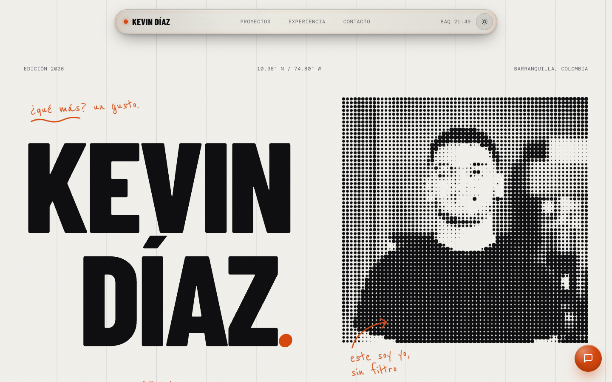
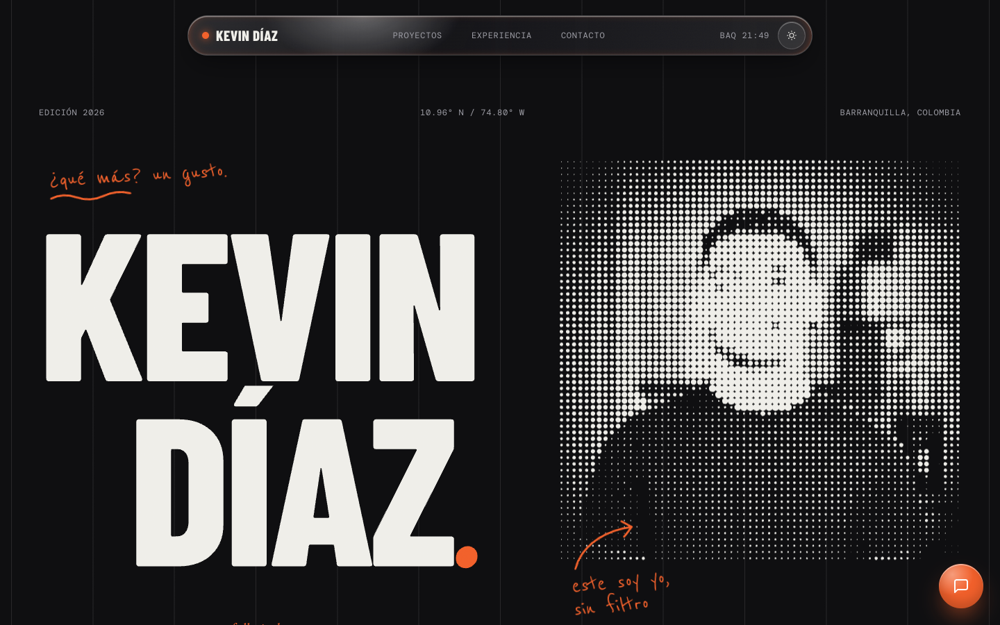
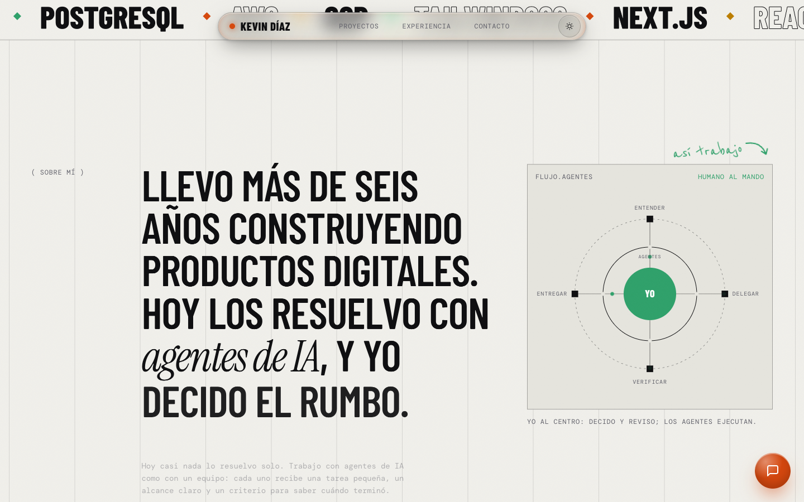

# Kevin Díaz · Portafolio

Portafolio personal de Kevin Díaz, desarrollador full-stack en Barranquilla, Colombia. Una sola página con retrato de puntos interactivo, tema claro y oscuro, y un asistente de IA que responde con los datos de mi hoja de vida.

**Sitio:** https://kevindev.co

| Claro | Oscuro |
|---|---|
|  |  |



## Hecho con

- Astro y React
- TypeScript
- CSS propio y animaciones nativas del navegador
- Un asistente de IA conversacional

## Estructura

```
src/
├── components/
│   ├── portfolio/     # Página principal: Portfolio.astro, portfolio.ts, portfolio.css
│   └── islands/       # ChatBot.tsx
├── features/chatbot/  # Asistente conversacional
└── pages/             # Páginas del sitio
public/                # Fuentes, imágenes y CV
docs/screenshots/      # Capturas de este README
```

## Contacto

- GitHub: [@KevinDM15](https://github.com/KevinDM15)
- LinkedIn: [kevindm14](https://www.linkedin.com/in/kevindm14/)
- Correo: kevindiazm.14@gmail.com

## Licencia

Código de portafolio personal. Puedes usarlo como inspiración, pero no lo copies tal cual.
